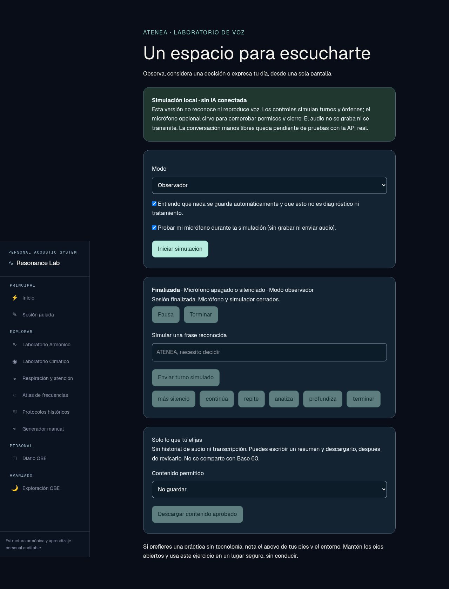
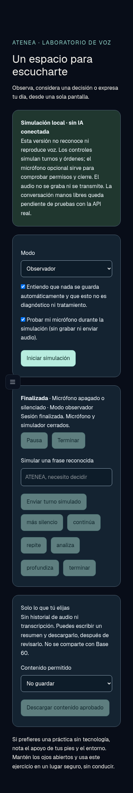

# Evidencia local de ATENEA (26 oct 2026)

Datos sintéticos, sin credenciales, audio grabado ni solicitudes a OpenAI.

- `tests.txt`: suite completa de dominio/integración (38 archivos, sin fallos), incluidos 16 escenarios nuevos ATENEA.
- `typecheck.txt`, `lint.txt`: comandos completados con código 0.
- `ui-on.txt`: tres pruebas HTTP/escritorio/viewport móvil, sin fallos, dispositivo de audio falso de Chromium.
- `ui-off.txt`: gate HTTP pasa; las dos pruebas visuales no corresponden con flag apagado y se omiten.
- `desktop.png`, `mobile.png`: pantalla después de terminar; tracks finalizados y guardado desactivado.

La evidencia de GitHub Actions se enlaza desde el PR. Ninguna de estas pruebas acredita WebRTC real, micrófono físico, silencios acústicos, cierre remoto facturable o compatibilidad iOS/Android. Véase `../../ATENEA_VOZ_MVP.md` para pendientes y NO-GO.
